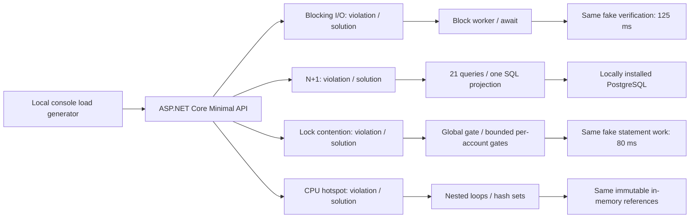
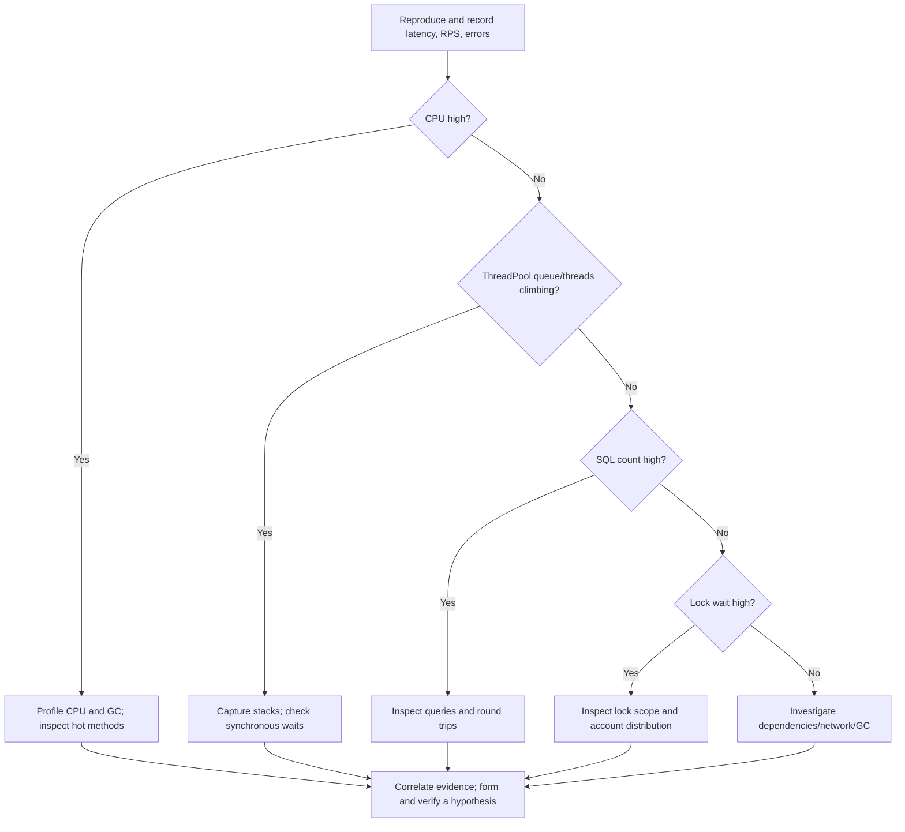
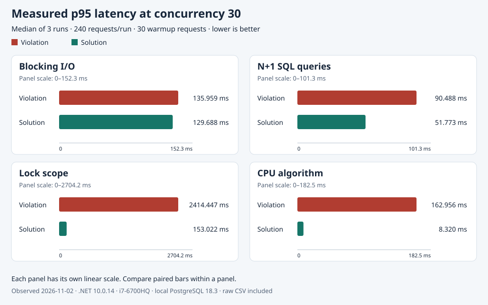

# ASP.NET Core performance bottlenecks under load

**An API is fast for one user. With concurrent traffic, latency rises and throughput stops scaling. What is actually limiting it?**

This runnable, local C# showcase follows **Violation → Diagnosis → Solution → Verification**. Four independent experiments use a fictional account-reporting domain to separate blocked workers, excessive database round trips, overly broad synchronization, and expensive computation. Every pair preserves its business response. The purpose is to explain a root cause with evidence before changing code.

## At a glance

| Area | Choice |
| --- | --- |
| Runtime | .NET 10 LTS / ASP.NET Core 10, `net10.0`; SDK 10.0.403, runtime 10.0.14 |
| Database | EF Core 10.0.14 + Npgsql EF provider 10.0.3; locally installed PostgreSQL |
| Application | Minimal HTTP REST API; no frontend or real financial operations |
| Developer tool | Small BCL-only console load generator; no test framework |
| Data | Accounts `1`–`20`; deterministic, fictional USD amounts stored as `long` minor units |
| Infrastructure | One developer machine. No containers, cloud, deployment path, or external integrations |

Versions were checked against the [stable EF Core package](https://www.nuget.org/packages/Microsoft.EntityFrameworkCore/10.0.14), [Npgsql provider package](https://www.nuget.org/packages/Npgsql.EntityFrameworkCore.PostgreSQL/10.0.3), and [.NET 10 downloads](https://dotnet.microsoft.com/en-us/download/dotnet/10.0). The provider accepts EF Core versions `>= 10.0.4` and `< 11.0.0`. Dependencies are pinned; previews are excluded.

| Experiment | Violation source | Solution source |
| --- | --- | --- |
| Blocking I/O | [BlockingIoEndpoints.cs — `Violation`](src/AspNetCorePerformanceBottlenecks.Api/Endpoints/BlockingIoEndpoints.cs) | [Same file — `SolutionAsync`](src/AspNetCorePerformanceBottlenecks.Api/Endpoints/BlockingIoEndpoints.cs) |
| N+1 queries | [NPlusOneEndpoints.cs — `ViolationAsync`](src/AspNetCorePerformanceBottlenecks.Api/Endpoints/NPlusOneEndpoints.cs) | [Same file — `SolutionAsync`](src/AspNetCorePerformanceBottlenecks.Api/Endpoints/NPlusOneEndpoints.cs) |
| Lock contention | [StatementGenerationService.cs — `ViolationAsync`](src/AspNetCorePerformanceBottlenecks.Api/Services/StatementGenerationService.cs) | [Same file — `SolutionAsync`](src/AspNetCorePerformanceBottlenecks.Api/Services/StatementGenerationService.cs) |
| CPU hotspot | [DuplicateReferenceService.cs — `Violation`](src/AspNetCorePerformanceBottlenecks.Api/Services/DuplicateReferenceService.cs) | [Same file — `Solution`](src/AspNetCorePerformanceBottlenecks.Api/Services/DuplicateReferenceService.cs) |

Read [the results](#performance-results), [run locally](#run-locally), or follow [the diagnostic cheat sheet](#diagnostic-tool-cheat-sheet).

## The simulated incident

An account-reporting API responds quickly during a single-user demonstration. More users arrive at once. Responses slow down, throughput flattens, and sufficiently heavy traffic could cause request timeouts. This is a **simulated incident**, not a story about a real bank. Timeouts and resource exhaustion are hypotheses until a run actually records them.

The same symptom can have different causes. A worker blocked on I/O needs a different fix from a CPU-bound loop. A database doing 21 round trips needs a different fix from a statement generator serializing unrelated accounts.

## Architecture and request paths



The API owns all DTOs, synthetic data, EF mappings, and diagnostic headers. The console tool communicates only over HTTP; it imports no API code. PostgreSQL is used only by the N+1 routes after startup. The other experiments do not query it. Startup requires a reachable, pre-created demo database and completes schema initialization and seeding before `/health` becomes reachable. Health is a readiness signal for that startup, not a continuous database probe.

| Route family | Violation | Solution |
| --- | --- | --- |
| Blocking I/O | `GET /api/performance/blocking-io/{accountId}/violation` | `GET /api/performance/blocking-io/{accountId}/solution` |
| N+1 | `GET /api/performance/n-plus-one/violation` | `GET /api/performance/n-plus-one/solution` |
| Lock contention | `GET /api/performance/lock-contention/{accountId}/violation` | `GET /api/performance/lock-contention/{accountId}/solution` |
| CPU hotspot | `GET /api/performance/cpu-hotspot/{accountId}/violation` | `GET /api/performance/cpu-hotspot/{accountId}/solution` |

Account IDs must be integers: malformed/nonpositive IDs return **400**, positive unknown IDs return **404**, and known IDs return **200**. Work sizes are fixed; no caller can request an arbitrarily large batch. All failures use ASP.NET Core problem responses. `GET /health` returns `{"status":"ready"}` after seeding.

## How to investigate before changing code

1. **Reproduce locally.** Follow [Run locally](#run-locally), start PostgreSQL first, use Release, and wait for the dataset-ready and listening logs. Check `/health`. Keep other traffic quiet.
2. **Check correctness first.** Run `--verify-equivalence` for each pair. Performance improvements that change business output are invalid comparisons.
3. **Establish a low-concurrency baseline.** Use the same request count, account distribution, warmup, runtime, and logging settings for both variants. Record successful RPS and p50/p95/p99, as well as failures. Then raise concurrency; keep paired workloads identical and record any request-count change between levels.
4. **Inspect errors.** Separate non-2xx responses, request timeouts, connection exceptions, cancellations, and work never started. Low latency among a few successes does not excuse a high failure rate.
5. **Inspect runtime pressure.** Monitor CPU, allocation/GC activity, ThreadPool threads/queue, and active HTTP requests while load is running. Low CPU with slow responses suggests waiting; high CPU suggests computation or GC. Neither is proof by itself.
6. **Inspect database commands.** Compare `X-Demo-Sql-Commands`; enable SQL command logging briefly and inspect whether the optimized `SUM` is in SQL. Request-scoped counts must remain stable under concurrency.
7. **Inspect synchronization.** Compare `X-Demo-Lock-Wait-Ms` under identical mixed-account traffic, then repeat with a fixed account. Async semaphore waits do not block worker threads, but can still serialize throughput.
8. **Inspect stacks or profile.** Capture blocked stacks during blocking load. Sample CPU during the CPU violation. Correlate the actual hot/waiting method with the metric pattern.
9. **Form one hypothesis and make one focused change.** The solution method alongside each violation changes only the suspected bottleneck. Re-run equivalent traffic, alternate order, and repeat comparisons.
10. **Verify both behavior and mechanism.** Preserve JSON, compare p95/p99/RPS, and check the root-cause evidence. Document inconsistent results instead of selecting a flattering run.



This tree suggests a next investigation, not a classifier: several bottlenecks can coexist in a real system, and a low SQL count does not prove an efficient query.

| Symptom | Evidence to collect | Root cause here | Focused fix | Proof to seek |
| --- | --- | --- | --- | --- |
| Slow responses with blocked workers | ThreadPool trends + blocked stacks | Sync-over-async | Await the same I/O | Equivalent JSON; fewer blocking stacks; RPS/tail comparison |
| Slow account summaries | SQL count + generated SQL | Explicit `1 + N` queries | Server-side aggregate projection | Equivalent totals; 21 → 1 commands; load comparison |
| Unrelated statements queue | Per-request semaphore wait | One gate for every account | One gate per known account | Mixed-account wait drops; same-account serialization remains |
| CPU work limits throughput | CPU sample + operation counts | Repeated O(n²) comparisons | Ordinal hash sets | Same 300 duplicated references; reduced work; load comparison |

The following case-study commands assume the API is running and this variable is set in the load terminal at the repository root:

```bash
LG=tools/AspNetCorePerformanceBottlenecks.LoadGenerator
```

## Case A: blocking I/O and ThreadPool pressure

**Symptoms and scenario.** An account summary waits for a fictional verification dependency. Both variants spend 125 ms in the same cancellable `Task.Delay`. At concurrency one they should look similar. Under load the violation occupies request workers while no CPU work is being done.

**Violation** ([handler](src/AspNetCorePerformanceBottlenecks.Api/Endpoints/BlockingIoEndpoints.cs)):

```csharp
var status = service.CheckAsync(accountId, cancellationToken).GetAwaiter().GetResult();
```

**Diagnosis.**

1. Reproduce with the commands below; repeat with concurrency `1`. Keep the same mixed account sequence for both variants.
2. During violation load, inspect ThreadPool thread count and queue length alongside CPU. Capture `dotnet-stack report` while requests are pending.
3. Look for `BlockingIoEndpoints.Violation` → task wait frames such as `Task.InternalWaitCore` / `Task.SpinThenBlockingWait`. The actual blocking expression above is the root cause. A queue spike alone does not identify it.
4. Compare threads/queue and tail latency across repetitions. .NET compensates for recognized blocking and adjusts its pool. Warm pools, core count, and runtime version can reduce or eliminate a visible latency gap; blocked-worker cost still exists. See [Microsoft's starvation walkthrough](https://learn.microsoft.com/en-us/dotnet/core/diagnostics/debug-threadpool-starvation).

```bash
dotnet run --project "$LG" -c Release --no-build -- --scenario blocking-io --variant violation --concurrency 30 --requests 240 --warmup 30
dotnet run --project "$LG" -c Release --no-build -- --scenario blocking-io --variant solution --concurrency 30 --requests 240 --warmup 30
```

**Solution** ([handler](src/AspNetCorePerformanceBottlenecks.Api/Endpoints/BlockingIoEndpoints.cs)):

```csharp
var status = await service.CheckAsync(accountId, cancellationToken);
```

**Verification.** Run the equivalence command below; compare p95/p99/RPS in [recorded results](#performance-results), then correlate the blocking frames and runtime trends. `X-Demo-Duration-Ms` measures the operation, not end-to-end client latency.

```bash
dotnet run --project "$LG" -c Release --no-build -- --scenario blocking-io --verify-equivalence
```

**Trade-offs / limits.** Async waiting saves workers, not the dependency's 125 ms. `.Result`, `.Wait()`, and `Thread.Sleep` are related blocking patterns, not extra demonstrations here. `Task.Run` merely moves blocking to another pool worker. Do not increase minimum threads to disguise the root cause; the project does not tune ThreadPool settings.

## Case B: explicit EF Core N+1 queries

**Symptoms and scenario.** A summary lists all 20 accounts and their transaction totals. PostgreSQL holds 100 deterministic transactions per account (2,000 total). App CPU can appear normal while sequential round trips hold up the response.

**Violation** ([handler](src/AspNetCorePerformanceBottlenecks.Api/Endpoints/NPlusOneEndpoints.cs)):

```csharp
foreach (var account in accounts)
{
    var total = await db.Transactions.AsNoTracking().Where(t => t.AccountId == account.Id)
        .SumAsync(t => (long?)t.AmountMinor, cancellationToken) ?? 0L;
    summaries.Add(new AccountSummary(account.Id, account.Name, account.Currency, total));
}
```

**Diagnosis.**

1. Warm both routes after startup. Use `curl -i` to inspect `X-Demo-Sql-Commands`: expect 21 for the violation, one for the solution, and confirm actual values.
2. Run the equivalent traffic below. The [scoped interceptor](src/AspNetCorePerformanceBottlenecks.Api/Data/DbCommandCountingInterceptor.cs) counts async SQL command attempts, including reader execution used by `SumAsync`; startup has a separate DI scope and is excluded.
3. Enable EF command logging as described in the cheat sheet. Inspect one account-list query and 20 repeated sums, versus one ordered, bounded SQL projection containing the aggregate. This demonstrates round trips; it does not establish connection-pool exhaustion.
4. Inspect the SQL before materialization. `.Select(...Sum(...)).ToListAsync(...)` keeps aggregation in PostgreSQL. Moving `ToList` earlier would change where the computation happens. See [EF's efficient querying guidance](https://learn.microsoft.com/en-us/ef/core/performance/efficient-querying).

```bash
curl -i http://localhost:5080/api/performance/n-plus-one/violation
curl -i http://localhost:5080/api/performance/n-plus-one/solution
dotnet run --project "$LG" -c Release --no-build -- --scenario n-plus-one --variant violation --concurrency 30 --requests 240 --warmup 30
dotnet run --project "$LG" -c Release --no-build -- --scenario n-plus-one --variant solution --concurrency 30 --requests 240 --warmup 30
```

**Solution** ([handler](src/AspNetCorePerformanceBottlenecks.Api/Endpoints/NPlusOneEndpoints.cs)):

```csharp
var summaries = await db.Accounts.AsNoTracking().OrderBy(a => a.Id).Take(DemoAccounts.Count)
    .Select(a => new AccountSummary(a.Id, a.Name, a.Currency,
        a.Transactions.Sum(t => (long?)t.AmountMinor) ?? 0L))
    .ToListAsync(cancellationToken);
```

**Verification.** Compare ordered arrays and totals, SQL counts under concurrency, generated SQL, and p95/p99/RPS. With the seed, account 1 totals `45350` minor units and account 20 totals `235350`. Empty transaction sets sum to zero on both paths.

```bash
dotnet run --project "$LG" -c Release --no-build -- --scenario n-plus-one --verify-equivalence
```

**Trade-offs / limits.** One SQL command may still contain a correlated subquery; one command does not mean one table scan. The foreign-key index supports account lookups. A missing index, poor plan, oversized payload, excessive materialization, or a saturated connection pool could require other changes. No lazy-loading proxies, parallel DbContext use, sensitive-data logging, or provider substitution is involved.

## Case C: a lock with the wrong scope

**Symptoms and scenario.** A fake statement dependency supports one generation at a time **per account**. Different accounts can proceed independently. Both paths await the same 80 ms work and return the same deterministic statement.

**Violation** ([service](src/AspNetCorePerformanceBottlenecks.Api/Services/StatementGenerationService.cs)):

```csharp
return GenerateAsync(accountId, _globalGate, cancellationToken);
```

**Diagnosis.**

1. Run the round-robin mixed-account traffic below for each variant separately. Request index `i` selects `1 + i % 20`; the same mapping is repeated every run, regardless of completion order.
2. Compare mean/p95 lock wait from `X-Demo-Lock-Wait-Ms` and client p95/p99/RPS. Time includes waiting for acquisition, not statement work.
3. Low CPU plus high wait suggests serialization. All accounts use one gate in the violation, so throughput tends toward roughly one completion per 80 ms even with unrelated accounts queued. This theoretical bound is not a measured result.
4. Repeat with `--account-id 1`. Both variants should serialize that account and have similar service capacity. This control distinguishes a correctly scoped fix from incorrectly removing required synchronization.

```bash
dotnet run --project "$LG" -c Release --no-build -- --scenario lock-contention --variant violation --concurrency 30 --requests 240 --warmup 30
dotnet run --project "$LG" -c Release --no-build -- --scenario lock-contention --variant solution --concurrency 30 --requests 240 --warmup 30
# Repeat BOTH commands with --account-id 1 for the same-account control.
```

**Solution** ([service](src/AspNetCorePerformanceBottlenecks.Api/Services/StatementGenerationService.cs)):

```csharp
return GenerateAsync(accountId, _accountGates[accountId - 1], cancellationToken);
// Shared generation method, used by both paths:
await gate.WaitAsync(cancellationToken);
try { /* await identical statement work */ }
finally { gate.Release(); }
```

**Verification.** Check equivalent statements, mixed-account wait/RPS/tails, and the fixed-account control. Acquisition happens before `try`; cancellation before acquisition never releases a gate. Acquisition followed by cancellation releases in `finally`. The singleton owns and disposes all 20 pre-created account gates and the violation gate.

```bash
dotnet run --project "$LG" -c Release --no-build -- --scenario lock-contention --verify-equivalence
```

**Trade-offs / limits.** There is no unbounded dictionary keyed by user input. Different-account concurrency does not help hot single-account traffic. Compare one variant at a time: the two variants model separate lock domains for the experiment. These are process-local gates, not distributed locks; a multi-process production system would need a different consistency design.

## Case D: inefficient CPU processing

**Symptoms and scenario.** Each known account has an immutable batch of 1,800 ordinal reference strings: 1,500 distinct references, of which the first 300 occur twice. The operation counts **distinct reference values appearing more than once**, not the number of extra occurrences. Only the input is prebuilt; neither route caches an answer.

**Violation** ([service](src/AspNetCorePerformanceBottlenecks.Api/Services/DuplicateReferenceService.cs)):

```csharp
for (var j = i + 1; j < references.Length; j++)
{
    comparisons++;
    if (StringComparer.Ordinal.Equals(references[i], references[j]))
    {
        duplicates++;
        break;
    }
}
```

This inner scan runs for each first appearance after an earlier scan skips already-seen values. The source increments the comparison count at each `StringComparer.Ordinal.Equals` call; there is no injected wait or artificial allocation.

**Diagnosis.**

1. Run both paths with identical traffic below. Check `X-Demo-Operations` and `X-Demo-Duration-Ms` for a single request as well.
2. Monitor CPU and GC under violation load; if CPU is high, take a short sampled trace and find `DuplicateReferenceService.Violation` and ordinal string comparisons. High CPU alone does not prove this particular algorithm is responsible.
3. Compare the repeated scans with the hash-set pass. The violation has quadratic worst-case work, while hashing has expected linear work. Cancellation is checked during both loops, and batch size is fixed.

```bash
curl -i http://localhost:5080/api/performance/cpu-hotspot/1/violation
curl -i http://localhost:5080/api/performance/cpu-hotspot/1/solution
dotnet run --project "$LG" -c Release --no-build -- --scenario cpu-hotspot --variant violation --concurrency 30 --requests 240 --warmup 30
dotnet run --project "$LG" -c Release --no-build -- --scenario cpu-hotspot --variant solution --concurrency 30 --requests 240 --warmup 30
```

**Solution** ([service](src/AspNetCorePerformanceBottlenecks.Api/Services/DuplicateReferenceService.cs)):

```csharp
var seen = new HashSet<string>(StringComparer.Ordinal);
var duplicated = new HashSet<string>(StringComparer.Ordinal);
foreach (var reference in _batches[accountId])
    if (!seen.Add(reference))
        duplicated.Add(reference);
return (duplicated.Count, hashOperations);
```

**Verification.** Both return `duplicateReferenceCount: 300` for all 20 accounts. Compare p95/p99/RPS and operation durations. `X-Demo-Operations` counts **string equality comparisons** for the nested loops and **hash-set Add attempts** for the solution; these are different units and cannot be converted directly into a speed ratio.

```bash
dotnet run --project "$LG" -c Release --no-build -- --scenario cpu-hotspot --verify-equivalence
```

**Trade-offs / limits.** Hash sets use O(n) extra per-request memory and depend on hash behavior; no universal timing ratio is promised. Allocation can matter at much larger sizes. Making this CPU work `async` or using `Task.Run` does not eliminate its CPU cost.

## Performance results

**Observed locally on 2026-11-02:** Ubuntu 24.04.4 LTS; Intel i7-6700HQ (4 cores / 8 logical CPUs); approximately 16 GiB RAM; SDK 10.0.403; .NET/ASP.NET Core 10.0.14; EF Core 10.0.14; Npgsql 10.0.3; PostgreSQL 18.3 over loopback. Release build, default quiet logging, client/API/database on the same machine.

All **48 main runs** completed with **zero failures, timeouts, exceptions, cancellations, or unstarted requests**. Each row below is the median of three run-level statistics, not a percentile of pooled samples. Each run warmed 30 requests outside timing; variant order was alternated. Full conditions and individual rows are in the [measurement record](docs/measurements/README.md) and [raw CSV](docs/measurements/local-runs.csv).

### Concurrency 1: 80 measured requests per run, three runs per variant

| Scenario | Variant | Successful RPS | p50 ms | p95 ms | p99 ms | Failures |
| --- | --- | ---: | ---: | ---: | ---: | ---: |
| blocking-io | violation | 7.91 | 126.276 | 127.204 | 134.016 | 0/240 |
| blocking-io | solution | 7.93 | 126.073 | 126.761 | 131.077 | 0/240 |
| n-plus-one | violation | 56.93 | 15.473 | 34.684 | 41.543 | 0/240 |
| n-plus-one | solution | 351.23 | 2.768 | 4.727 | 6.006 | 0/240 |
| lock-contention | violation | 12.31 | 80.843 | 82.260 | 86.031 | 0/240 |
| lock-contention | solution | 12.28 | 81.312 | 81.760 | 84.211 | 0/240 |
| cpu-hotspot | violation | 56.57 | 16.540 | 24.411 | 26.340 | 0/240 |
| cpu-hotspot | solution | 1401.79 | 0.620 | 0.824 | 3.429 | 0/240 |

### Concurrency 30: 240 measured requests per run, three runs per variant

| Scenario | Variant | Successful RPS | p50 ms | p95 ms | p99 ms | Failures |
| --- | --- | ---: | ---: | ---: | ---: | ---: |
| blocking-io | violation | 224.65 | 127.012 | 135.959 | 136.696 | 0/720 |
| blocking-io | solution | 232.96 | 126.745 | 129.688 | 130.841 | 0/720 |
| n-plus-one | violation | 432.47 | 64.293 | 90.488 | 98.775 | 0/720 |
| n-plus-one | solution | 1168.88 | 21.216 | 51.773 | 60.073 | 0/720 |
| lock-contention | violation | 12.43 | 2411.856 | 2414.447 | 2415.843 | 0/720 |
| lock-contention | solution | 244.12 | 92.896 | 153.022 | 156.075 | 0/720 |
| cpu-hotspot | violation | 263.49 | 101.150 | 162.956 | 177.826 | 0/720 |
| cpu-hotspot | solution | 3728.15 | 4.086 | 8.320 | 10.261 | 0/720 |



### What the evidence supports

- **Blocking I/O:** warmed latency and throughput were similar at concurrency 30. These measurements do **not** establish a consistent starvation-related speedup. A separate stack snapshot captured 30 workers in `BlockingIoEndpoints.Violation` through `Task.InternalWaitCore`; the solution snapshot had none. ThreadPool compensation and prior warmup matter.

- **N+1:** every observed request reported 21 versus 1 SQL commands, including concurrent checks. Command logging confirmed SQL-side aggregation. Latency/throughput improved in this local workload; no pool-exhaustion claim is made.

- **Lock scope:** median per-run mean lock wait was 2184.218 ms versus 35.052 ms under mixed accounts. The [same-account control](docs/measurements/same-account.csv) retains required serialization; inspect its separate conditions rather than comparing it directly with the 30-client runs.

- **CPU algorithm:** both return 300 duplicated reference values. The measured work was 2,698,800 ordinal equality comparisons versus 2,100 hash-set Add attempts per request; these are algorithm-specific units, not a direct timing ratio. The higher-concurrency measurements favor the linear algorithm.

Short solution runs, especially the CPU solution, show scheduling/client overhead and run-to-run variation. The chart uses separate panel scales and reports median run-level p95; raw rows remain available. No universal percentage improvement or production capacity is inferred.

Separate instrumented runs collected 18 one-second runtime samples per variant. Blocking-violation threads grew from 4 to 39, with queue length at most 1; solution threads remained at 38–39 because the same process retained workers. This is evidence of blocked workers and compensation, **not sustained starvation**. The CPU-violation median reported CPU usage was 55.29% (maximum 79.86%), versus 5.36% for the solution during repeated bounded batches. Those diagnostic batches are separate from the latency tables and do not establish full-machine saturation. See [runtime samples and caveats](docs/measurements/README.md#runtime-and-stack-evidence).

## Run locally

### Prerequisites and local PostgreSQL

Install the stable [.NET 10 SDK](https://dotnet.microsoft.com/en-us/download/dotnet/10.0) with SDK `10.0.403` or a later stable patch in that feature band (`global.json` uses `latestPatch`). Install a supported PostgreSQL release using the [official OS-specific downloads](https://www.postgresql.org/download/). `psql` is useful for setup and troubleshooting. Start the locally installed PostgreSQL service using your OS's service manager. The [PostgreSQL server startup documentation](https://www.postgresql.org/docs/current/server-start.html) covers manual startup. No container or deployment setup is needed.

Using an appropriately privileged **local PostgreSQL administrator** account, create a dedicated role and an empty database. The following are **nonfunctional templates**: replace `demo_user` with your locally chosen demo role name and `REPLACE_WITH_LOCAL_DUMMY_PASSWORD` with a local-only password. Do not commit the chosen password. Run `CREATE DATABASE` separately, outside an explicit transaction.

```sql
CREATE ROLE demo_user WITH LOGIN NOSUPERUSER NOCREATEDB NOCREATEROLE
    PASSWORD 'REPLACE_WITH_LOCAL_DUMMY_PASSWORD';
```

```sql
CREATE DATABASE aspnetcore_performance_bottlenecks OWNER demo_user;
```

The administrator needs permission to create roles/databases; the API role does not. Ownership of its dedicated demo database lets it create its own schema objects. No superuser, cluster-wide creation privileges, or access to other applications' data is needed. The syntax and permission rules are documented for [CREATE ROLE](https://www.postgresql.org/docs/current/sql-createrole.html) and [CREATE DATABASE](https://www.postgresql.org/docs/current/sql-createdatabase.html).

Verify using your chosen role; `-W` prompts for the locally chosen password:

```bash
pg_isready -h localhost -p 5432
psql -h localhost -p 5432 -U demo_user -d aspnetcore_performance_bottlenecks -W -c 'SELECT current_user, current_database();'
```

Use **only this disposable demo database**. Startup first checks connectivity, then calls `EnsureCreatedAsync` to initialize its schema and idempotently inserts missing deterministic IDs inside a transaction. It never calls `EnsureDeletedAsync`. Run only one seeding instance at a time; concurrent startup seeders are outside this small demo's scope. Seeding preserves existing rows, so use an empty dedicated database and do not modify its synthetic data during measurements. For an evolving production schema, use migrations rather than `EnsureCreated`.

### Configure the connection without tracked credentials

The key is `ConnectionStrings:FintechDb`. Tracked `appsettings.json` contains no connection string. This illustrative Npgsql template will not authenticate until you create the role and replace the placeholders:

```text
Host=localhost;Port=5432;Database=aspnetcore_performance_bottlenecks;Username=demo_user;Password=REPLACE_WITH_LOCAL_DUMMY_PASSWORD;Pooling=true
```

Npgsql uses semicolon-separated keywords; see its [connection-string reference](https://www.npgsql.org/doc/connection-string-parameters.html) for quoting special characters. The app rejects non-loopback database hosts. Choose either configuration path below. Both contain **placeholders only**; the actual values belong on your machine.

**Option A — .NET user secrets** (loaded by this local-only app in Release as well):

```bash
dotnet user-secrets set 'ConnectionStrings:FintechDb' 'Host=localhost;Port=5432;Database=aspnetcore_performance_bottlenecks;Username=demo_user;Password=REPLACE_WITH_LOCAL_DUMMY_PASSWORD;Pooling=true' --project src/AspNetCorePerformanceBottlenecks.Api
```

**Option B — environment variable**, set in the API terminal (Bash example; use your shell's equivalent on other OSs):

```bash
export ConnectionStrings__FintechDb='Host=localhost;Port=5432;Database=aspnetcore_performance_bottlenecks;Username=demo_user;Password=REPLACE_WITH_LOCAL_DUMMY_PASSWORD;Pooling=true'
```

Environment values override user secrets. User secrets are outside the repository and are not an encrypted secret vault. Avoid putting actual passwords in shared command transcripts or shell history. No real integrations or API credentials are required.

### Restore, build, start, and smoke check

From `aspnetcore-performance-bottlenecks/`:

```bash
dotnet --info
dotnet restore
dotnet build -c Release -warnaserror
dotnet run --project src/AspNetCorePerformanceBottlenecks.Api --configuration Release --no-launch-profile -- --urls http://localhost:5080
```

Wait for `Synthetic dataset ready` and `Now listening`. In another terminal:

```bash
curl http://localhost:5080/health
curl -i http://localhost:5080/api/performance/blocking-io/1/violation
curl -i http://localhost:5080/api/performance/blocking-io/1/solution
curl -i http://localhost:5080/api/performance/n-plus-one/violation
curl -i http://localhost:5080/api/performance/n-plus-one/solution
curl -i http://localhost:5080/api/performance/lock-contention/1/violation
curl -i http://localhost:5080/api/performance/lock-contention/1/solution
curl -i http://localhost:5080/api/performance/cpu-hotspot/1/violation
curl -i http://localhost:5080/api/performance/cpu-hotspot/1/solution
# Input checks: expect 400, 400, and 404 respectively.
curl -i http://localhost:5080/api/performance/blocking-io/not-an-integer/solution
curl -i http://localhost:5080/api/performance/blocking-io/0/solution
curl -i http://localhost:5080/api/performance/blocking-io/21/solution
```

Compare response bodies manually by saving each pair with `curl -sS URL -o local-results/violation.json` and `...solution.json`, then `diff` them (or use your editor's comparison). Diagnostics are in headers, so do not compare `curl -i` output as business JSON. The console's `--verify-equivalence` mode parses JSON and compares all 20 accounts; the N+1 list is compared once. It is a manual developer check, not a test suite.

### Run bounded, equivalent loads

**Only target your own local API. Do not aim load at third-party hosts or production systems.** The utility accepts only loopback HTTP(S) origins, disables proxies and redirects, shares one `HttpClient`, supports Ctrl+C, and uses a 15-second timeout. Bounds: concurrency `1..100`, requests `1..10000`, warmup `0..200`, fixed account IDs `1..20`.

```bash
LG=tools/AspNetCorePerformanceBottlenecks.LoadGenerator
dotnet run --project "$LG" -c Release --no-build -- --help
mkdir -p local-results
# Warm and compare all four business pairs.
for scenario in blocking-io n-plus-one lock-contention cpu-hotspot; do
  dotnet run --project "$LG" -c Release --no-build -- --scenario "$scenario" --verify-equivalence
done
# All four patterns; replace violation with solution for the paired run.
dotnet run --project "$LG" -c Release --no-build -- --scenario blocking-io --variant violation --concurrency 30 --requests 240 --warmup 30 --csv local-results/results.csv
dotnet run --project "$LG" -c Release --no-build -- --scenario n-plus-one --variant violation --concurrency 30 --requests 240 --warmup 30 --csv local-results/results.csv
dotnet run --project "$LG" -c Release --no-build -- --scenario lock-contention --variant violation --concurrency 30 --requests 240 --warmup 30 --csv local-results/results.csv
dotnet run --project "$LG" -c Release --no-build -- --scenario cpu-hotspot --variant violation --concurrency 30 --requests 240 --warmup 30 --csv local-results/results.csv
```

For a repeatable comparison, warm both variants first, alternate their order across three repetitions, and keep each scenario's distribution identical. Run one benchmark process at a time. Start with concurrency `1`; then try `10`, `30`, and `50` as machine capacity permits. A compact protocol matching the recorded workload is:

```bash
for scenario in blocking-io n-plus-one lock-contention cpu-hotspot; do
  for concurrency in 1 30; do
    requests=80
    if [ "$concurrency" -eq 30 ]; then requests=240; fi
    for repetition in 1 2 3; do
      variants='violation solution'
      if [ "$repetition" -eq 2 ]; then variants='solution violation'; fi
      for variant in $variants; do
        dotnet run --project "$LG" -c Release --no-build -- --scenario "$scenario" --variant "$variant" --concurrency "$concurrency" --requests "$requests" --warmup 30 --csv local-results/results.csv
      done
    done
  done
done
```

Repeat lock runs with `--account-id 1` as the serialization control. Warmup uses the configured bounded concurrency, must all succeed, and is excluded from measurements. Use a warmup count at least as large as concurrency (30 in the recorded protocol) to exercise the concurrent connection paths before timing. A failed warmup records no benchmark. Console/CSV report completed attempts, successes, total failures, non-2xx, timeouts, exceptions, cancellations, unstarted work, elapsed time, successful RPS, and successful-request p50/p95/p99 using nearest rank. Failures are not hidden in successful percentiles. RPS uses successes divided by total measured wall time. Latency includes response-body transfer but excludes time waiting for the console's bounded worker slot; this is a closed-loop tool, not an open-loop production arrival model. Empty percentile samples are `n/a` in the console and blank in CSV. Exit codes: `0` success, `1` failed verification/warmup/load or CSV write, `2` invalid CLI input.

### PostgreSQL troubleshooting

| Failure | Check and local fix |
| --- | --- |
| Connection refused / no response | Start the installed service; check `pg_isready`, host and port. If 5432 is occupied, choose the correct cluster's port and update both `psql` and the connection string. |
| Password authentication failed / no matching host rule | Check your locally chosen role/password and database; inspect your installation's `pg_hba.conf` rules for loopback IPv4/IPv6 and reload the service after a deliberate change. Do not enable broad trust access. See [client authentication](https://www.postgresql.org/docs/current/client-authentication.html). |
| Database does not exist | An administrator must pre-create the database. `EnsureCreatedAsync` initializes the schema here; the API role intentionally has no `CREATEDB` privilege. |
| Permission denied for schema `public` | In `psql`, inspect `\l` and `\dn+`; verify the dedicated role owns the demo database and has `USAGE, CREATE` on its schema. Database connectivity and permission to create tables are separate. As the local administrator, connected to the demo database, grant `USAGE, CREATE ON SCHEMA public TO demo_user` if needed. Do not grant superuser. |
| Wrong database owner | Verify `SELECT datname, pg_get_userbyid(datdba) FROM pg_database WHERE datname = 'aspnetcore_performance_bottlenecks';`. If this dedicated database was mis-created, the local administrator can correct its owner with `ALTER DATABASE aspnetcore_performance_bottlenecks OWNER TO demo_user;`. Existing table ownership may also need correction. |
| Existing unrelated tables / changed schema | Use a fresh dedicated disposable database. `EnsureCreated` is not a migration engine and will not repair an evolving schema. No automatic destructive reset is provided. |
| Port 5080 occupied | Stop your previous demo process or select another loopback port with `--urls`, then pass that origin to `--base-url`. |

After fixing permissions/configuration, restart the API to rerun idempotent seeding. No connection string or password needs to appear in source control.

## Diagnostic tool cheat sheet

Install the optional tools on your own machine; they are not application dependencies. Keep the tool major version compatible with the installed runtime:

```bash
dotnet tool install --global dotnet-counters --version '10.*'
dotnet tool install --global dotnet-stack --version '10.*'
dotnet tool install --global dotnet-trace --version '10.*'
dotnet-counters ps
dotnet-counters monitor --process-id <API_PID> --counters System.Runtime,Microsoft.AspNetCore.Hosting
dotnet-stack report --process-id <API_PID>
dotnet-trace collect --process-id <API_PID> --duration 00:00:00:15 --output local-results/cpu.nettrace
```

Replace `<API_PID>` with the API's numeric process ID; angle-bracket placeholders are not literal shell arguments. `dotnet-counters ps` lists processes: select `AspNetCorePerformanceBottlenecks.Api`, not the load generator or the `dotnet run` CLI parent. Attach as the same OS user with the required diagnostics permissions. Run help (`TOOL COMMAND --help`) if your installed tool differs. Traces can perturb timings; collect them in separate diagnostic runs.

| Tool / command | Signal | Hypothesis it supports | Caveat |
| --- | --- | --- | --- |
| Load generator, commands above | Successful RPS; client p50/p95/p99; all failure categories | A repeatable degradation at a given concurrency | Closed-loop, finite local traffic; client and server share hardware |
| `dotnet-counters monitor ...` | `dotnet.thread_pool.thread.count`, `dotnet.thread_pool.queue.length`, CPU, GC/allocation; older views use ThreadPool Thread Count / Queue Length labels | Blocked workers, CPU pressure, or allocation pressure | Sampling misses short spikes; thread growth alone is not starvation proof |
| `dotnet-stack report ...` | Actual waiting/blocking frames in the API | Sync-over-async request workers | A momentary snapshot; async semaphore waits do not look like monitor lock contention |
| `dotnet-trace collect ...` | Sampled call stacks and runtime events | Hot CPU method or correlated waits | Default profiles and available events vary by tool; absence of a sample is not proof of absence |
| EF command logging + `X-Demo-Sql-Commands` | Actual SQL, command attempts per request | Repeated round trips / correct server aggregation | Counts say nothing about query-plan cost; interceptor covers this app's async execution paths |
| `X-Demo-Lock-Wait-Ms` | Time waiting for this demo's semaphore | Gate scope serializes unrelated accounts | .NET monitor-contention counters do not directly measure `SemaphoreSlim.WaitAsync` |
| `X-Demo-Duration-Ms`, `X-Demo-Operations` | Local operation time and algorithm-specific work | Excessive CPU algorithm work | Headers exclude serialization/transport; operation units differ between CPU algorithms |
| Optional PostgreSQL `pg_stat_activity` | Active queries, state/wait events in the local database | Database-side waiting or concurrency | Snapshot, permissions-dependent; not proof of Npgsql pool exhaustion |

To temporarily log SQL, restart the API with this argument appended after `--` (alongside `--urls`):

```bash
dotnet run --project src/AspNetCorePerformanceBottlenecks.Api -c Release --no-build --no-launch-profile -- --urls http://localhost:5080 --Logging:LogLevel:Microsoft.EntityFrameworkCore.Database.Command=Information
```

Sensitive-data logging stays disabled. Issue one N+1 pair, inspect the generated PostgreSQL SQL, then return to the default Warning logging before measuring either variant. Per-operation structured logs can likewise be enabled with `--Logging:LogLevel:Default=Information` for diagnosis, but should be held consistent across comparisons.

ASP.NET Core's `Microsoft.AspNetCore.Hosting` meter includes `http.server.request.duration` (a histogram) and `http.server.active_requests`. Collecting a histogram alone does not automatically yield p95/p99 without suitable aggregation; this project's percentiles come from the console tool. See [HTTP metrics](https://learn.microsoft.com/en-us/aspnet/core/metrics/http?view=aspnetcore-10.0) and the official [counters](https://learn.microsoft.com/en-us/dotnet/core/diagnostics/dotnet-counters), [stack](https://learn.microsoft.com/en-us/dotnet/core/diagnostics/dotnet-stack), and [trace](https://learn.microsoft.com/en-us/dotnet/core/diagnostics/dotnet-trace) references.

## Other possible bottlenecks (not implemented)

| Candidate | How to distinguish it |
| --- | --- |
| PostgreSQL/Npgsql pool exhaustion | Correlate connection acquisition waits/timeouts with pool use and DB capacity; a high SQL count alone does not prove it. |
| Missing index / poor query plan | Inspect actual SQL and PostgreSQL `EXPLAIN` on the synthetic data; high execution time with a low command count can still be a DB bottleneck. |
| Excessive materialization / payload size | Compare rows, response bytes, allocations and GC with database execution time; projection may help even without changing round trips. |
| External dependency saturation | Measure dependency latency/concurrency and errors separately from API processing; async does not add capacity to a downstream system. |
| GC/allocation pressure | Correlate allocations, collections and pauses with latency, then inspect allocation stacks; CPU utilization may include GC work. |
| Network latency | Separate connection/transport time from handler duration; this loopback showcase cannot represent a remote network. |
| API request queues | Compare active requests, server queue signals and client timings; find the constrained resource before increasing queue limits. |

These are investigation directions, not claims that this repository reproduces them.

## Engineering lessons and an interview-ready explanation

“I would reproduce the slowdown with bounded traffic and record latency percentiles, throughput, and errors. I would compare CPU and runtime pressure with database and dependency evidence. If workers are blocked, I would inspect their stacks; if SQL repeats per account, I would count round trips; if unrelated accounts queue, I would inspect lock scope; if CPU is busy, I would profile the hot method. I would change the identified mechanism, preserve the business response, then repeat equivalent traffic and confirm both the mechanism and user-visible result.”

Increasing threads can conceal blocking while adding resource cost. Caching introduces freshness and invalidation decisions and can hide inefficient work. Scaling servers can multiply database pressure. Async helps waiting but cannot remove quadratic computation or required single-account serialization. Each can be useful when evidence supports it; none is a universal answer.

## Limitations

- Synthetic, fixed datasets and fake dependency delays; no real banking logic or data.
- Locally installed PostgreSQL on one developer machine; this is not a production-equivalent database environment.
- Finite closed-loop measurements, machine-state/JIT/ThreadPool effects, and shared client/server CPU; no universal benchmark claim.
- No distributed tracing backend, deployment path, multi-process locking, or production security/authentication design.
- No unit or integration test projects by request. Manual smoke/equivalence checks and the developer load tool are the verification mechanism.
- Input is cached for the CPU exercise; answers are always recomputed. No hidden answer cache, extra violation-only latency, or ThreadPool tuning.

## Sources / further reading

- [.NET supported versions and LTS lifecycle](https://dotnet.microsoft.com/en-us/platform/support/policy)
- [Debug ThreadPool starvation](https://learn.microsoft.com/en-us/dotnet/core/diagnostics/debug-threadpool-starvation)
- [dotnet-counters](https://learn.microsoft.com/en-us/dotnet/core/diagnostics/dotnet-counters), [dotnet-stack](https://learn.microsoft.com/en-us/dotnet/core/diagnostics/dotnet-stack), [dotnet-trace](https://learn.microsoft.com/en-us/dotnet/core/diagnostics/dotnet-trace)
- [EF Core efficient querying](https://learn.microsoft.com/en-us/ef/core/performance/efficient-querying)
- [ASP.NET Core built-in HTTP metrics](https://learn.microsoft.com/en-us/aspnet/core/metrics/http?view=aspnetcore-10.0)
- [Npgsql EF provider](https://www.npgsql.org/efcore/) and [connection strings](https://www.npgsql.org/doc/connection-string-parameters.html)
- [PostgreSQL downloads](https://www.postgresql.org/download/), [CREATE ROLE](https://www.postgresql.org/docs/current/sql-createrole.html), [CREATE DATABASE](https://www.postgresql.org/docs/current/sql-createdatabase.html)
